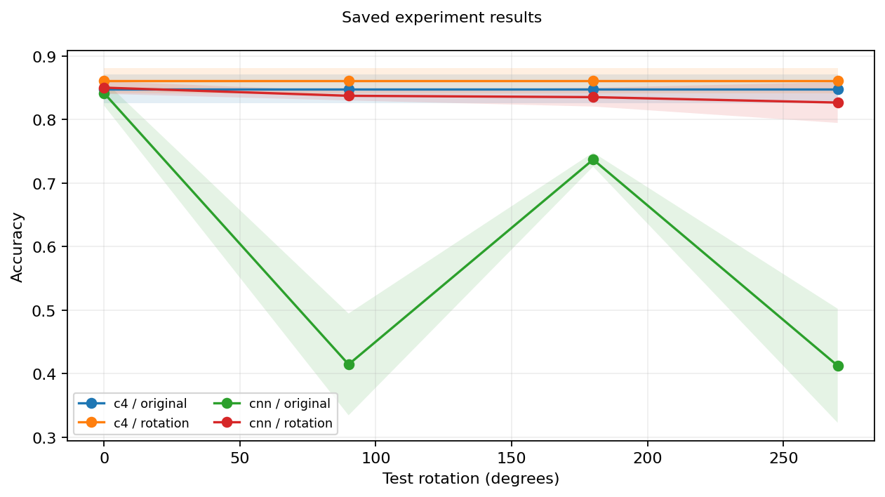

# Group-Equivariant CNNs: Rotation Symmetry and Data Augmentation

Does building C4 rotation symmetry into a classifier help more than learning from
rotated examples? This exploratory BreastMNIST study compares a CNN with an ESCNN
C4 G-CNN, with and without uniform C4 augmentation, across three seeds.

**The runs used 100 Adam updates; convergence was not established.** CNN validation
accuracy fluctuated substantially, with no established cause. This is reconstructed
research code, developed with AI-assisted coding and checked with regression and
numerical tests; it is not the original thesis implementation.

## Main results

Four-angle test accuracy, mean ± sample SD across seeds 42, 123 and 456:

| Model | Parameters | No augmentation | C4 augmentation |
|---|---:|---:|---:|
| CNN | 43,029 | 60.15% ± 4.07% | 83.76% ± 1.54% |
| C4 G-CNN | 38,710 | 84.83% ± 2.25% | 86.11% ± 1.96% |

With augmentation, C4−CNN is +2.35 percentage points (paired-seed 95% t interval
−2.23 to +6.93), which does not establish a clear C4 advantage.

Archived secondary test measurements, mean across three seeds at 0°:

| Model / training | Macro-F1 | Malignant-class F1 | AUROC |
|---|---:|---:|---:|
| CNN / none | 78.67% | 67.86% | 87.00% |
| CNN / C4 augmentation | 78.34% | 66.29% | 84.59% |
| C4 / none | 79.02% | 68.09% | 87.97% |
| C4 / C4 augmentation | 81.27% | 71.82% | 88.62% |

These are archived measurements from saved predictions. They cannot be independently recomputed or verified from the public accuracy-only tables; raw predictions and probabilities remain in the local research archive.



[Per-seed/angle measurements](results/per_angle_accuracy.csv),
[accuracy summaries](results/accuracy_summary.csv),
[paired comparisons](results/paired_accuracy.csv), and the
[interval figure](results/figures/paired_confidence_intervals.png) are included.

## Install and test

From the repository root, using Python 3.10–3.12 on Linux:

```bash
python -m venv .venv
source .venv/bin/activate
python -m pip install -c constraints.txt -e '.[test,medical]'
python -m pip check
python -m pytest -q
```

Use a compatible Torch/torchvision pair for your CPU/CUDA platform. ESCNN's py3nj
may require Fortran and BLAS/LAPACK build tools. Tests use small synthetic fixtures,
including optimizer/recovery checks; they need no source datasets or historical weights.

## Reproduce the published accuracy analysis

```bash
python -m scripts.analyze --output .reproduced/accuracy --check results --plots
```

Use a fresh output directory. This recomputes four-angle seed summaries and paired
intervals from the 48 published seed/angle accuracies, checks all numeric table cells
within 1e−12, and plots the same quantities. Figure rendering can differ by version.
It does **not** recompute predictions or validate each underlying classification.
Image-level bootstrap, F1/AUROC, duplicate-exclusion sensitivity, histories and original
checkpoint diagnostics require the full local archive and are not publicly reproduced here.

## Run the main experiment

Obtain the official 28×28 `breastmnist.npz` from [MedMNIST](https://medmnist.com/)
and place it in `data/`. The [main configuration](configs/breastmnist.yaml) requires
CUDA, uses all official partitions, and disables automatic downloads.

```bash
python -m scripts.train_matrix --config configs/breastmnist.yaml --status
python -m scripts.train --config configs/breastmnist.yaml --results runs/breastmnist_analysis
```

The second command trains twelve runs and evaluates the selected checkpoints.
Use fresh output roots; it writes checkpoints under `runs/breastmnist/` and full
analysis under `runs/breastmnist_analysis/`. It records new configuration, source,
data and environment provenance. New runs need not reproduce historical weights
bit for bit. No research training was performed to prepare this export.

See [methodology](docs/methodology.md) for models, evaluation and further analysis
commands, and [limitations](docs/limitations.md) before interpreting the results.
Original development records and provenance remain intact locally; this compact
export contains neither source images nor weights. Unexecuted experiment proposals
are outside its scope. Code is [MIT licensed](LICENSE); dataset rights remain with providers.
